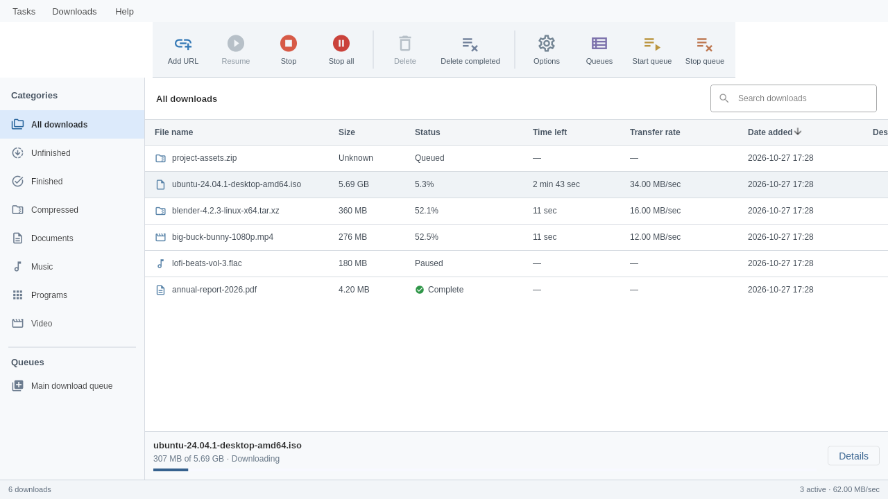
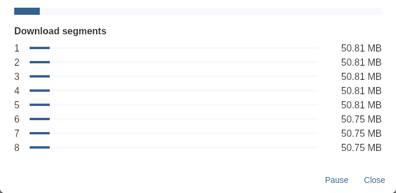
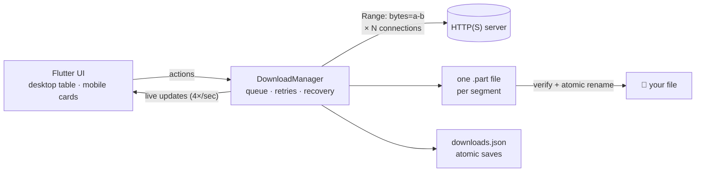

<div align="center">


# Flux Download Manager

**Multi-connection, resumable downloads. One open-source app for every device you own.**

Flux is on its way to becoming the **closest open-source alternative to IDM**,<br>
for Windows, Linux, macOS, Android and iOS.

[](#-roadmap)
[](ROADMAP.md)
[](LICENSE)
[](https://github.com/DhrubaDC1/flux-dm/stargazers)
<br>
[](https://flutter.dev)
[](https://dart.dev)
[](#-platforms)
[](https://github.com/DhrubaDC1/flux-dm/commits)

[Features](#-features) · [Platforms](#-platforms) · [Download](#-download) · [Roadmap](#-roadmap) · [Quick start](#-quick-start) · [How it works](#-how-it-works) · [Contributing](#-contributing)

<br>



</div>

> [!IMPORTANT]
> 🚧 **Flux is under active development.** The download engine works today and passes
> a native end-to-end test on Linux. It is **not production-ready yet**: Windows, macOS
> and iOS builds are untested on real devices, and background downloads and browser
> capture are still on the [roadmap](#-roadmap). ⭐ **Star the repo** to follow progress.

## ✨ Features

**Available today**

|  |  |
| --- | --- |
| ⚡ **Multi-connection downloads** | Splits each file into up to 32 byte ranges, each fetched over its own connection. |
| ⏯ **Pause and resume, even after a restart** | Partial data and the segment layout are saved. Resume requests only the bytes still missing. |
| 🛡 **Corruption-proof** | ETag/Last-Modified checks spot a file that changed on the server and restart it safely. Every range response is validated. |
| 🔁 **Smart retries** | Brief network failures are retried with backoff, and partial data is always kept. |
| 🗂 **Auto categories** | Compressed, Documents, Music, Programs and Video, plus search and sortable columns. |
| 📋 **Download queue** | Download now or later, start and stop the queue, and limit simultaneous downloads. |
| 🔒 **Never overwrites your files** | Collision-safe names, Unicode-safe filenames on every OS and a crash-safe final save. |
| 📱 **Adaptive UI** | A classic toolbar-and-table layout on desktop, with a drawer and cards on phones. |

<div align="center">

<br><sub>Every connection is visible: one 5.7 GB file downloading over 8 parallel segments.</sub>
</div>

### Flux vs IDM

|  | **Flux** | IDM |
| --- | :---: | :---: |
| Open source | ✅ GPL-3.0 | ❌ |
| Price | Free | Paid after trial |
| Linux · macOS · Android · iOS | ✅ one codebase | ❌ Windows only |
| Multi-connection segmented downloads | ✅ | ✅ |
| Pause/resume across restarts | ✅ | ✅ |
| Dynamic segmentation | 🗓 planned | ✅ |
| Scheduler and speed limiter | 🗓 planned | ✅ |
| Browser integration | 🗓 planned | ✅ |
| Site and media grabber | 🗓 planned | ✅ |

## 💻 Platforms

| Platform | Status |
| --- | --- |
| 🐧 **Linux** | ✅ Builds and passes a native end-to-end test: add → pause → restart → resume → verify → delete |
| 🤖 **Android** | 🟡 Release APK builds in CI; not yet tested on a device |
| 🪟 **Windows** | 🟡 Builds in CI; not yet tested on a PC |
| 🍎 **macOS** | 🟡 Builds in CI (Intel and Apple Silicon); not yet tested on a Mac |
| 📱 **iOS** | 🟡 Unsigned build in CI; not yet tested on a device |

## 📦 Download

Preview builds for every platform are on the [Releases page](https://github.com/DhrubaDC1/flux-dm/releases).
They are **unsigned**, so your system will warn you the first time you open them.

| Platform | File | First launch |
| --- | --- | --- |
| 🐧 **Linux** | `-linux-x64.tar.gz` | Extract and run `flux-dm/flux_dm`. Needs GTK 3 and glibc 2.35 or newer (Ubuntu 22.04, Debian 12 and later). |
| 🪟 **Windows** | `-windows-x64.zip` | Extract and run `flux-dm\flux_dm.exe`. If SmartScreen appears, choose **More info → Run anyway**. |
| 🍎 **macOS** | `-macos.zip` | Unzip, move the app to Applications and open it once. Then go to **System Settings → Privacy & Security → Open Anyway**, or run `xattr -dr com.apple.quarantine "/Applications/Flux Download Manager.app"`. |
| 🤖 **Android** | `-android.apk` | Open the APK and allow installs from that app when asked. |
| 📱 **iOS** | `-ios-unsigned.ipa` | Install with a sideloading tool such as AltStore or Sideloadly, which signs it with your own Apple ID. |

## 🧭 Roadmap

**Overall: 11 of 34 roadmap items done (32%).** Full acceptance criteria are in [ROADMAP.md](ROADMAP.md).

| Milestone | Progress | Done |
| --- | --- | :---: |
| **M0** Behavior specification | `████████████████░░░░` 80% | 4 / 5 |
| **M1** Usable download core | `██████████████████░░` 88% | 7 / 8 |
| **M2** Engine and queue fidelity | `░░░░░░░░░░░░░░░░░░░░` 0% | 0 / 6 |
| **M3** Native background operation | `░░░░░░░░░░░░░░░░░░░░` 0% | 0 / 4 |
| **M4** Advanced protocols and capture | `░░░░░░░░░░░░░░░░░░░░` 0% | 0 / 5 |
| **M5** Production release | `░░░░░░░░░░░░░░░░░░░░` 0% | 0 / 6 |

<details>
<summary><b>✅ Done</b></summary>

- Real HTTP(S) streaming with parallel ranges and a single-stream fallback
- Pause/resume, saved partial downloads and safe restart when the file changed on the server
- Strict range, length and encoding checks with bounded retries
- Queue limits plus download-now and download-later
- Collision-safe output, portable Unicode filenames and crash-safe publishing
- Adaptive desktop and mobile UI: Add URL → file info → now/later, sortable list, categories, search, progress and segments
- 23 tests against real local HTTP servers, plus a native Linux end-to-end test
- Behavior specification and architecture decision

</details>

<details>
<summary><b>🔜 Up next (M1 and M2)</b></summary>

- Native end-to-end runs on Android, Windows, macOS and iOS
- Dynamic splitting: idle connections take over half of a slow segment
- Named and sync queues, drag ordering, schedules with start and stop times
- Per-file and global speed limits, per-host connection limits, quotas
- Duplicate-file choices, save folders per category and refreshing expired links
- Batch URLs, text import/export and clipboard capture

</details>

<details>
<summary><b>🌅 Later (M3 to M5)</b></summary>

- Android foreground service and notifications, iOS background downloads, macOS tray
- HTTP auth, cookies, headers and proxies with secure credential storage
- Browser extension and mobile share integration
- Site grabber and media downloads (no DRM circumvention)
- Fault injection, performance profiling, accessibility, localization and dark mode
- Signed installers and release CI for all five platforms

</details>

## 🚀 Quick start

You need [Flutter](https://docs.flutter.dev/get-started/install) 3.47 or newer (verified on 3.47.8) and the toolchain for your platform.

```sh
git clone https://github.com/DhrubaDC1/flux-dm.git
cd flux-dm
flutter pub get
flutter run -d linux        # or: windows · macos · a connected Android/iOS device
```

To build a standalone Linux app:

```sh
flutter build linux --release
./build/linux/x64/release/bundle/flux_dm
```

Click **Add URL**, paste an HTTP(S) link, check the name and folder, then choose **Start download** or **Download later**.

## 🔧 How it works



1. **Probe** the server with `Range: bytes=0-0` to learn the size and whether it supports ranges.
2. **Split** the file into fixed ranges and save that layout and the server's validator *before* writing a byte.
3. **Stream** each segment over its own connection into its own part file.
4. **Resume** from the actual size of each part file on disk, and only if the server's ETag/Last-Modified still matches.
5. **Publish** by assembling into a temporary file, checking its length and atomically renaming it into place.

The engine is pure Dart (`lib/core/`, no Flutter imports), so it is easy to test and reuse. Read the full [architecture decision](docs/architecture.md).

## 🧪 Testing

```sh
flutter analyze
flutter test                          # 23 core + widget tests
FLUTTER=flutter tool/linux_smoke.sh   # native Linux end-to-end (needs xvfb-run)
```

Tests use real local HTTP servers and real files: malformed and ignored ranges, files changed mid-download, interrupted transfers, unknown sizes, redirects, queue limits, filename collisions, Unicode limits and an interrupted final save.

## 📁 Project structure

```
lib/
├── core/        # Pure-Dart transfer engine: model, manager, recovery
├── ui/          # Flutter UI: app shell, dialogs, formatting
└── main.dart    # Platform directories and app startup
test/            # Core and widget tests against real local servers
integration_test # Native end-to-end test, run by tool/linux_smoke.sh
docs/            # Architecture decision, screenshots and logo
```

## 🤝 Contributing

Contributions are very welcome. Flux is early, so this is a good time to shape it.

1. Pick an unchecked item from the [roadmap](ROADMAP.md), or open an issue to discuss an idea.
2. Fork, branch and keep tests realistic: use local HTTP servers, not mocks.
3. Make sure `flutter analyze` is clean and `flutter test` passes, then open a pull request.

**Have a Windows PC, a Mac or an Android phone?** Running Flux and reporting what happens is one of the most valuable contributions right now.

## ⭐ Star history

<a href="https://star-history.com/#DhrubaDC1/flux-dm&Date">
  
</a>

## 📜 License

Flux is free software under the [GNU GPL v3.0](LICENSE). © 2026 Dhruba Chakraborty.

<sub>Flux is an independent project. It is not affiliated with, endorsed by or connected to Tonec Inc. Internet Download Manager and IDM are trademarks of their respective owner.</sub>
